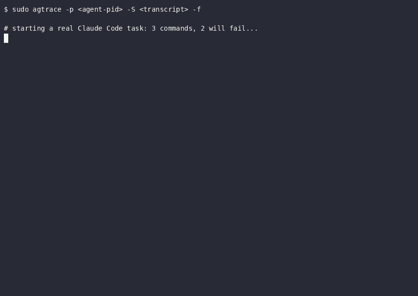

# agtrace

[](https://github.com/ywu010622/agtrace/actions/workflows/ci.yml)
[](https://github.com/ywu010622/agtrace/actions/workflows/release.yml)
[](LICENSE)

**strace for AI agents.** One live timeline joining what the agent *claims* with what the kernel *actually did*.



## Why

An agent transcript tells you what the agent *intended* — tool calls, model text, results. The kernel tells you what *actually happened* — processes forked, files opened, connections made, syscalls failed. When the two disagree, the transcript alone cannot explain it:

- a sandbox silently swallowed the command (`bwrap` never initialized — `curl` never ran)
- the agent retried with the sandbox off, `curl` really executed, and exited 7 (connection refused)
- a `tool.result` says "success" while the real work happened in a different process tree

agtrace tails the agent transcript **and** traces the kernel (in-process eBPF) in real time, binding each `tool.call` to the processes it actually spawned — so you can see the exact point where intent and reality diverge.

agtrace only **presents**. It never throttles, kills, edits config, or auto-remediates. Acting on what you see is a different tool's job.

## Features

- **Unified live timeline** — agent, runtime, infra, and policy layers on a single clock
- **Adapters** — Claude Code transcripts, DeepSeek Harness session logs (live zstd frame tail), a generic JSONL protocol for LangChain/LangGraph/anything, and an openshell fixture
- **tool.call ↔ exec binding** — every Bash call linked to its real `execve`; the match rule is shown honestly (`exact` / `substring` / `segment`), bound subtrees marked `=`
- **Failure attribution** — each failed call traced to its deepest evidence layer: `BEFORE exec` (sandbox init failed / command not found), `kernel` (exit status + linked syscalls); one red `XX` line per failure, plus a `--- failures (N)` summary footer
- **Watchlist** — sensitive files, exfiltration patterns, destructive commands surface in red (alert-only)
- **Noise folding** — `execvp` PATH probes and fork bursts collapsed to one derived line (`--no-collapse` restores the raw firehose)
- **Credential redaction** on by default (`--redact off|argv|argv+content`)
- **Transcript-only mode** — `-S` without `-p` needs neither root nor eBPF: the agent layer, derived views and JSON output still work

## Quickstart

Requirements: Linux with eBPF and BTF (`/sys/kernel/btf/vmlinux`), `sudo`, and an
agent session to watch. Nothing else: the eBPF programs are loaded in-process by
[aya](https://aya-rs.dev), so `bpftrace` is not a dependency. It is still
supported as a fallback backend (`--collector bpftrace`) and used automatically
only if the aya collector cannot start — with a note on stderr when that happens.
The agent layer alone (`-S` without `-p`/`-C`) runs unprivileged and on any
platform where the binary builds; on WSL it can tail a Windows-side DeepSeek
Harness session log read-only.

```bash
cargo install --git https://github.com/ywu010622/agtrace
```

Attach to a running Claude Code session:

```bash
P=$(pgrep -nx claude)                             # the agent process
T=$(ls -t ~/.claude/projects/*/*.jsonl | head -1) # its transcript
sudo agtrace -p "$P" -S "$T" -f
```

What to look for: `derived bind` (call ↔ process linked), red `XX` (failure attribution), `>>` (suspected retry), `!!` (watchlist hit).

Show only the failures:

```bash
sudo agtrace -p "$P" -S "$T" -f --failures-only
```

## Example

A real session — the agent runs three commands, two fail. agtrace binds each call to its kernel evidence and attributes each failure to its deepest layer:

```text
2.025000  agent    a740509c  tool.call   Bash  cmd="foobarxyz123 --version; ls /nonexistent-dir-abc; ..." ?
4.615000  XX       -         fail        tool.call Bash "foobarxyz123 --version" -> BEFORE exec: command not found (no execve)
4.616000  XX       -         fail        tool.call Bash "ls /nonexistent-dir-abc" -> kernel: exit(2), 35 linked events
--- failures (2):
    BEFORE exec: command not found (no execve) x1
    kernel: exit(2) x1
```

Machine-readable when you need it: `--output json` emits JSONL (one event per line, summary last) with `jq` recipes in `--help`.

## How it works

```
agent transcript (JSONL, live tail) ─┐
                                     ├─► merge (200 ms window, one clock) ─► render
kernel events (eBPF tracepoints) ────┘        execve / fork / exit / openat / connect / sendto
```

- **Collector**: eBPF tracepoint programs, built into the binary and loaded by `aya`
  in-process (attach takes ~150 ms, versus 2-3 s for a `sudo bpftrace` subprocess —
  short agent tasks used to finish before bpftrace was even attached). They filter by
  PID tree or cgroup, seeded from userspace, so agtrace never traces system-wide. The
  bpftrace script is still shipped and selected with `--collector bpftrace`.
- **Adapters**: `claude-code` (default; transcript JSONL as a live feed), `openshell` (stub on the same event interface), `jsonl` (generic: tails a file of agent events — one JSON object per line — so custom agents can plug in; see below).
- **Derived views**: binding, failure attribution, retry detection, watchlist — computed from evidence, never asserted without it. A failed call with no kernel evidence is reported as `no-kernel-source`, not guessed at.

See [DESIGN.md](DESIGN.md) for the full design (event model, clock discipline, evidence rules).

## Custom agents (LangChain, LangGraph, ...)

The kernel half (`-p`/`-C`) needs no adapter — it follows any process tree.
To get the agent layer (tool calls, model I/O) for binding and failure
attribution, emit events as JSONL and tail them with `--adapter jsonl`:

```bash
# 1. emit events from your agent (see examples/langchain_callback.py):
from langchain_callback import AgtraceCallbackHandler
handler = AgtraceCallbackHandler("/tmp/agtrace-events.jsonl")
agent = create_react_agent(model, tools, callbacks=[handler])

# 2. watch it live (PID = your agent process):
sudo agtrace --adapter jsonl -S /tmp/agtrace-events.jsonl -p <pid> -f
```

One JSON object per line; `ts` is ISO8601 or epoch seconds (missing = read time):

```json
{"type": "prompt",      "text": "do X", "ts": "2026-10-11T20:00:00.123Z"}
{"type": "tool.call",   "id": "call_1", "tool": "Bash", "command": "ls /tmp"}
{"type": "tool.result", "id": "call_1", "status": "success", "output": "..."}
{"type": "model.text",  "text": "I'll list /tmp"}
```

`id` correlates a call with its result (this is what `--failures-only` selects on).
For `tool.call`, `command` carries the shell command so argv binding works; other
tools correlate by time. Full schema: `src/adapter/jsonl.rs`.

## DeepSeek Harness (`--adapter dsh`)

DeepSeek Harness (DSH) writes each session to an append-only
`session.v4.jsonl.zstd` log: a concatenation of independent checksummed
Zstandard frames (one header frame, then one frame per 200 ms append batch).
`--adapter dsh` tails that container frame-by-frame, so the timeline appears
while the agent is still working.

```bash
# inside a DSH tool shell, or with DSH_HOME set: auto = current session
agtrace --adapter dsh -S auto -f

# or point at a session id / log path / workspace directly
agtrace --adapter dsh -S session-e8694b65 -f
agtrace --adapter dsh -S ~/.dsh/sessions/--home-me-proj--/session-…/session.v4.jsonl.zstd
```

What it maps: `user/message` → `agent.prompt`, `assistant/message` →
`agent.model.request` (derived once per step) / `agent.model.thinking` /
`agent.model.text`, `tool/call` → `agent.tool.call`, `tool/result` →
`agent.tool.result`. Harness-internal records (`step/*`, `job/*`, `request/*`,
team/subagent, approvals, …) are counted under `-v`, never mis-mapped.

**Honesty detail that matters for DSH:** a failed shell command does *not* set
`tool.result.isError` — the exit code lives in `job/settled.detail`
(`exit code: N`). agtrace reads that authoritative field, classifies the call as
`Failure`, and puts the disagreement in the event's `notes`; the text marker
`[exit code: N]` is only a fallback.

Discovery: `-S auto` uses `$DSH_SESSION_ID` when the harness exported it, else the
newest session of the current workspace, else the newest overall. The sessions
root is `$DSH_SESSIONS_ROOT` → `$DSH_HOME/sessions` → `~/.dsh/sessions`; on WSL it
also finds `<drive>:\Users\<user>\.dsh\sessions`. `projectKey()` (the
`--C-Users-me-proj--` directory naming), UTF-16 `~XXXX` escaping and generation
selection (`session.vN`) are ported from DSH's own persistence backend.

For DSH agents, a ready-made skill lives in
[`.agents/skills/agtrace/SKILL.md`](.agents/skills/agtrace/SKILL.md) (DSH
discovers `.agents/skills/` and `.dsh/skills/` in the project root, hot-reloaded):
copy it into a workspace, or `~/.dsh/skills/agtrace/SKILL.md` to make it available
everywhere, and the model can call it via the `skill` tool (humans: `/agtrace`).

Platform note: the transcript half is portable and works from WSL against the
Windows app's session logs. Kernel evidence (`-p`) is Linux-only — WSL cannot
observe Windows processes' syscalls — and WSL2's 5.15 kernel additionally
rejects the in-process eBPF object at the verifier, so live capture needs a
Linux host (or VM/distro) on kernel ≥ 6.8. Kernels whose
`sched_process_exit` tracepoint lacks `group_dead` (< 6.8, including WSL's
5.15) are handled by a group-leader fallback in both collectors instead of
failing to load.

## Status

v0.7.0. Adapters: Claude Code (live), DeepSeek Harness (live zstd frame tail),
generic jsonl (LangChain/LangGraph/any), openshell fixture. Single static Rust
binary; `cargo test` covers the unit suites plus `tests/inject.rs` (offline
kernel-line replay, 9 seeds) and `tests/dsh_e2e.rs` (synthetic DSH frame
streams), and `tests/real_cases.sh` replays real captured sessions.

Building from source needs two things beyond a stable toolchain: a **nightly**
toolchain (the eBPF crate is `no_std` and uses `-Z build-std=core`) and
[`bpf-linker`](https://github.com/aya-rs/bpf-linker):

```bash
cargo install bpf-linker          # one-time: links the eBPF object
cargo build --release             # builds the eBPF object and the binary
```

`cargo build --release` drives the nested eBPF build itself (see `build.rs`); there
is no second command to run. Note that `rustup target add bpfel-unknown-none` does
**not** work — that target has no prebuilt `core`, which is exactly why
`.cargo/config.toml` sets `build-std`. If the eBPF toolchain is missing, the build
prints a warning and produces a binary whose `--collector aya` degrades to bpftrace
rather than failing. CI pins a prebuilt
[`bpf-linker`](https://github.com/aya-rs/bpf-linker) (`v0.12.0`, static musl) so
no LLVM dev packages are needed; locally `cargo install bpf-linker` works too.

## Continuous integration

[`.github/workflows/ci.yml`](.github/workflows/ci.yml) runs on every push/PR,
weekly on a schedule, and on demand:

| Job | What it enforces |
|---|---|
| `rustfmt` | `cargo fmt --all --check` |
| `clippy (-D warnings)` | `cargo clippy --all-targets -- -D warnings` (host paths only; the embedded-object build is covered by the `test` job) |
| `build (eBPF) + tests` | stable host build, nightly `rust-src`, pinned `bpf-linker v0.12.0`, `cargo build --release`, **assert the embedded eBPF object is real (not the zero-byte stub)**, `cargo test` (366 tests: unit + offline kernel-replay e2e + DSH adapter e2e), and the release binary uploaded as an artifact |
| `cargo audit` | advisory dependency-advisory scan (does not block unrelated PRs) |

`build.rs` is deliberately allowed to degrade to a zero-byte eBPF stub when the
nightly/linker toolchain is absent. CI turns that degradation into a hard failure
for the shipped binary: a release with no `aya` collector must never be built by
accident. Reproduce the CI run locally with:

```bash
rustup toolchain install nightly --profile minimal --component rust-src
curl -fsSL -o /tmp/bpf-linker.tar.zst \
  "https://github.com/aya-rs/bpf-linker/releases/download/v0.12.0/bpf-linker-x86_64-unknown-linux-musl.tar.zst"
zstd -d -c /tmp/bpf-linker.tar.zst | tar -x -C "$HOME/.cargo/bin"
cargo fmt --all --check
cargo clippy --all-targets -- -D warnings
cargo build --release && cargo test
```

[`.github/workflows/release.yml`](.github/workflows/release.yml) publishes a
release for every `v*` tag: it rebuilds with the real eBPF object, re-runs the
test suite, refuses a tag that does not match the `Cargo.toml` version, and
uploads a tarball plus SHA-256 and a build-provenance attestation. Manual
`workflow_dispatch` runs do the same build/attest/upload without creating a
release. Dependabot (`.github/dependabot.yml`) keeps cargo and Actions inputs
current weekly; the eBPF toolchain is pinned in the workflows on purpose, since
the linker and the object ABI are coupled.

CI is Linux-only by design — the binary, `aya`/eBPF and `/proc` are Linux
interfaces; there is no macOS/Windows matrix to fake support that does not exist.

```bash
# release flow
git tag v0.7.0 && git push origin v0.7.0
```

## License

MIT — see [LICENSE](LICENSE).
